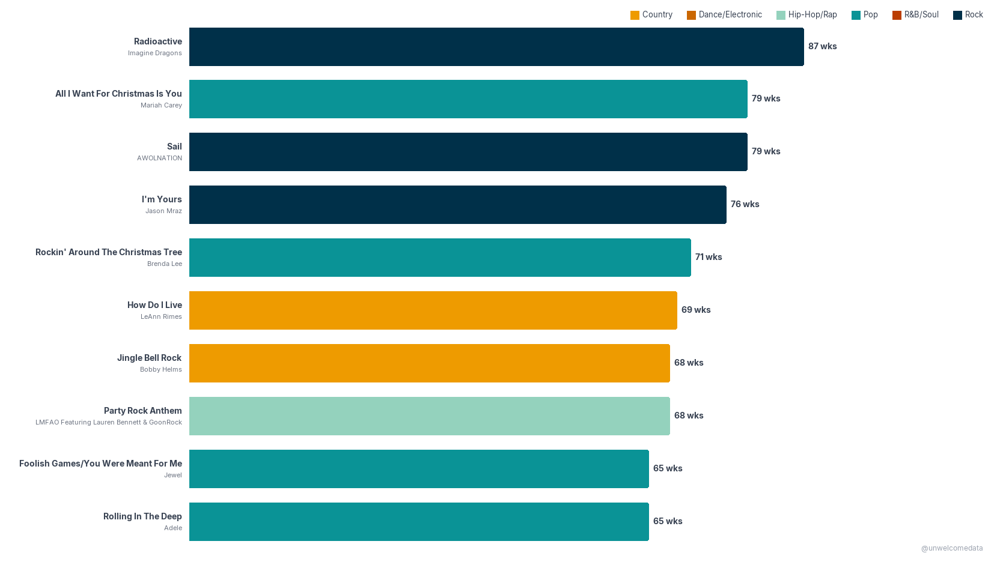
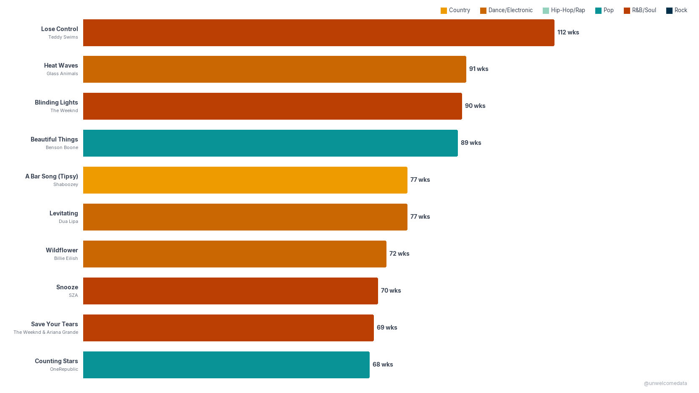

**[@unwelcomedata](https://github.com/unwelcomedata)** · data from public sources

# How genres rose and fell on the Billboard Hot 100

Seven decades of the Hot 100, read by genre. **Rock ruled the chart from the 1970s
into the 1990s, then slid to the bottom while Hip-Hop/Rap climbed from dead last to
#1 by the 2020s** — and when on-demand streaming entered the Hot 100 formula in 2013,
songs started staying on the chart nearly twice as long (the record jumped from 87
weeks to 112) and the longest-charting hits flipped genre, away from Rock/Pop/Country
toward R&B/Soul and Dance/Electronic.

---

_Click any chart to open it at full resolution._

## How it was measured

Two things get measured here, both straight from Billboard's own weekly Hot 100
chart history (1958–2026).

**Chart presence by genre.** Billboard carries no genre label, so each artist's
genre is assigned from **MusicBrainz** community tags — the single highest-count tag
per artist wins ("top-tag-wins"), applied at the **artist** level across their whole
catalog. A genre's "chart presence" in a year or decade is how many Hot 100 slots its
artists held. Genre is inherently subjective: a different taxonomy (Spotify, AllMusic,
Billboard's own genre charts) would shift the shares by a few points. **Other/Unknown**
is a coverage residual — unmatched artists plus the long tail of acts with fewer than
20 Hot 100 appearances, which were below the enrichment threshold — not a musical
category.

**Chart longevity.** "Longest-charting" means the total number of weeks a single song
ever spent on the Hot 100 (Billboard's running `weeks_on_chart` field), counted per
song.

**The load-bearing caveat — the Hot 100 formula changed.** The Hot 100 ranks a
*blended* metric: sales + radio airplay + online streaming. The weighting has shifted
over the decades, and the hinge for everything here is **2013, when on-demand
streaming (including YouTube) was folded directly into the formula** (video and bundle
rules shifted again around 2018–2020). So the post-2013 surge of Hip-Hop/Rap and Pop,
and the much longer chart runs, are **partly real listening and partly an artifact of
the modern multi-metric, streaming-weighted formula** — cross-era comparisons and the
pre-/post-2013 longevity split carry that caveat. The year-axis charts mark 2013
directly; the decade and song charts note it in context.

## 1. The genre rank race, by decade and by year

The lead chart tracks each of the **top six genres by chart appearances** (Rock, Pop,
R&B/Soul, Hip-Hop/Rap, Country, Dance/Electronic) by its **rank** over time — rank #1
at the top. Two grains of the same race: the **decade** view reads the long arc at a
glance, the **by-year** view shows every crossing. The dashed line marks **2013, when
streaming entered the formula**. (Other/Unknown is excluded from this ranking — it is a
coverage residual, not a genre.)

**By decade** — the clean arc: Rock #1 from the 1970s into the 1990s, Hip-Hop/Rap to #1
by the 2020s.

**By year** — the detailed version, every annual crossing from 1970 on.

## 2. Genre share of the Hot 100, by decade

The "how much" companion to the rank race: each decade's chart slots split across all
twelve genres as a 100% stacked bar. It makes the **Rock "mountain" of the 1970s–80s**
(nearly 40% of all slots in the 1980s) and the **Hip-Hop/Rap surge of the 2010s–20s**
read as area. Other/Unknown (grey) is kept in deliberately — a part-of-whole has to sum
to 100%, so hiding the coverage residual would misrepresent the early decades.
**The 2010s–20s decades reflect the post-2013 streaming-weighted formula.**

## 3 & 4. The longest-charting songs — before and during streaming

The ten songs that spent the **most total weeks on the Hot 100** in each era, split at
the 2013 streaming break. Each bar is a song (title as the label, artist beneath),
**colored by genre**, with values in **weeks on chart**. The pre-streaming top is still
dominated by 2008–2012 songs and perennial Christmas records (the streaming ramp had
already begun bleeding in), topping out at **87 weeks** (Radioactive). The streaming-era
songs run far longer — up to **112 weeks** (Lose Control) — and the genre mix flips:
**no Rock at all** in the streaming top ten, which leans R&B/Soul, Dance/Electronic,
and Pop.

**Pre-streaming (first charted 1958–2012)** — weeks on the Hot 100, by song, colored by
genre; max 87 weeks.

**Streaming era (first charted 2013–2026)** — same metric and genre colors; max 112
weeks, and no Rock in the top ten.

**Side by side** — the two eras on a shared scale, so the longevity jump (≈87 → 112
weeks) and the genre-mix flip read in a single glance.

## Explore any genre

Want a single genre's full trajectory? The **[genre picker](docs/genres.html)** plots
Hot 100 chart appearances per year, 1970 on, for any of the twelve genres (Blues,
Country, Dance/Electronic, Folk, Hip-Hop/Rap, Jazz, Latin, Metal, Other/Unknown, Pop,
R&B/Soul, Rock).

## The data

The published datasets are here:

- **[billboard_hot100_genre_v1.csv](export/billboard_hot100_genre_v1.csv)** — Hot 100
  chart appearances by year and genre (year, genre, appearances, share, rank).
- **[billboard_hot100_longest_charting_pre_streaming.csv](export/billboard_hot100_longest_charting_pre_streaming.csv)**
  and **[…_streaming_era.csv](export/billboard_hot100_longest_charting_streaming_era.csv)**
  — the two longest-charting song lists (song, artist, genre, weeks).
- A plain-English **codebook** accompanies each dataset (the `*_codebook.md` files in
  `export/`) describing every column.

## Sources & license

Full attribution — publisher, URLs, collection method, definitions, and the 2013 series
break — is in **[SOURCES.md](SOURCES.md)**.

- **Billboard Hot 100 chart history** via the public `mhollingshead/billboard-hot-100`
  dataset. Underlying chart © Billboard; used for non-commercial research only.
- **Genre tags** via **MusicBrainz** (community-contributed, CC0 / CC-BY-NC-SA).

This is a fun, pop-culture read, not an official Billboard product.

---

> **AI-Assisted Development**
> This project was built with the assistance of [Kiro](https://kiro.dev),
> an AI-powered development environment. All data sourcing decisions,
> methodology choices, and published findings are the responsibility of the
> author. AI was used for code generation, data pipeline construction, and
> research assistance — not for analysis conclusions or editorial judgment.
